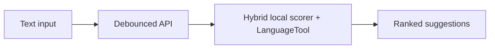
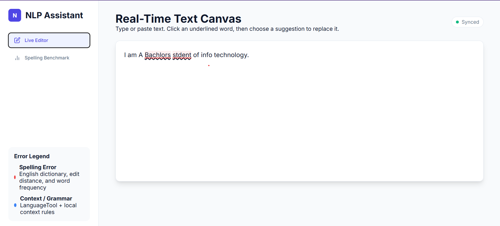
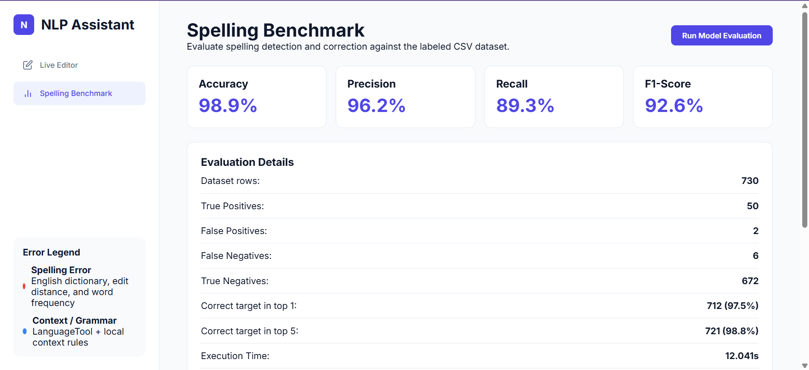

# NLP Text Assistant

NLP Text Assistant is a hybrid NLP spelling, grammar, and autocomplete engine with a browser-based editor. It combines a custom local spelling ranker with LanguageTool grammar checks and interactive correction suggestions.

## How it works



The local spelling engine generates candidates using edit distance, ranks them with Soundex phonetic encoding, character-bigram Dice similarity, and word frequency from the NLTK Brown Corpus. An English dictionary recognizes words and provides frequency fallback; optional custom words can be added locally. A few explicit local rules handle selected context patterns. LanguageTool checks grammar and spelling through its public API. The browser waits briefly after typing pauses before sending text for checking.

LanguageTool receives the text being checked when enabled. Disable it with `DISABLE_LANGUAGETOOL=1` to keep checks local. This is a hybrid rules-and-dictionary system, not a general-purpose semantic model; review suggestions before applying them.

### Interface & Evaluation Preview

<table>
  <tr>
    <td width="50%" align="center">
      <br/>
      <sub><b>Real-Time Text Canvas:</b> Debounced hybrid spelling, grammar, and autocomplete suggestions.</sub>
    </td>
    <td width="50%" align="center">
      <br/>
      <sub><b>Evaluation Dashboard:</b> Automated 730-pair benchmark reporting Accuracy, Precision, Recall, F1, and Top-K metrics.</sub>
    </td>
  </tr>
</table>

## Run locally

From the repository root:

```powershell
py -m venv .venv
.\.venv\Scripts\Activate.ps1
python -m pip install -r nlp-text-assistant\requirements.txt
python app.py
```

macOS or Linux:

```bash
python3 -m venv .venv
source .venv/bin/activate
pip install -r nlp-text-assistant/requirements.txt
python app.py
```

Open <http://127.0.0.1:5000>. On first startup, NLTK may download the Brown Corpus for frequency ranking. The English dictionary still supports spelling checks if the corpus is unavailable.

To disable the external LanguageTool check, set the environment variable before starting the app. In PowerShell:

```powershell
$env:DISABLE_LANGUAGETOOL = "1"
python app.py
```

On macOS or Linux:

```bash
DISABLE_LANGUAGETOOL=1 python app.py
```

## Evaluation

The spelling benchmark uses 730 labeled word pairs in `benchmark_500.csv` (the filename is historical). Results from the current engine:

| Metric | Result |
|---|---:|
| Typo-detection accuracy | 98.90% |
| Precision | 96.15% |
| Recall | 89.29% |
| F1 score | 92.59% |
| Expected correction in top 1 | 97.53% (712/730) |
| Expected correction in top 5 | 98.77% (721/730) |

Detection metrics measure whether the engine proposes a change. Top-1 and Top-5 are hit rates across all 730 rows, including already-correct examples, not typo-only correction rates. The benchmark page also evaluates four targeted local context-rule examples; this small set is a regression check, not a general grammar score.

Run the automated tests from the repository root:

```powershell
python -m unittest discover -s tests
```

## Project layout

`app.py`, `nlp_engine.py`, `api_aggregator.py`, and `context_rules.py` contain the Flask backend and text-checking logic. `nlp-text-assistant` contains the browser interface, its launcher, and Python requirements. The benchmark CSV files and automated tests are at the repository root.

To recognize names or specialist terms, add one word per line to a root-level `custom_words.txt` and restart the app.
